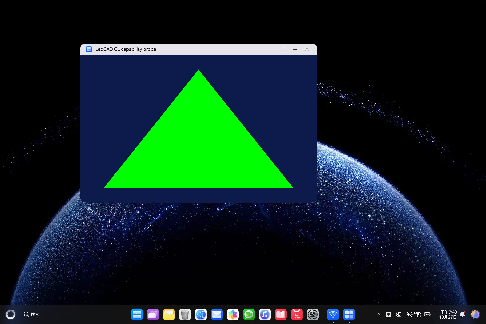

# D2 组长真机验收：通过

2026-10-27 提前完成原定 10/28 的组长任务：Qt Widgets + QOpenGLWidget 最小 HAP 已完成华为调试签名、安装、窗口显示和两轮独立运行。D2 的「真机出现 Qt 窗口和 GL 画面」出口已达到。本结论覆盖平台宿主与 GL 探针；小组其他成员的 D2 代码任务须分别验收。

## 包与源码

| 项目 | 值 |
| --- | --- |
| 探针源码提交 | `ebb767bc39bd2c66602a4c5ebfec234d28b20c38` |
| bundle / Ability | `io.github.xiaotaop.leocad.glprobe` / `QAbility` |
| 版本 | `0.2.0` / versionCode `1` |
| 签名 HAP | `build/harmony-render-probe/harmonyos-build/entry/build/default/outputs/default/entry-default-signed.hap` |
| 大小 | 70,886,774 字节 |
| SHA-256 | `0a7e34b0914af01aa8d548713b50d45207b10ea4349df5b0b04dfee171711ccf` |
| 签名 | DevEco CLI 官方自动生成的华为开发者调试证书及当前设备 Profile |
| 离线核验 | `verify-app`、原生 codesign、包摘要及权限签名均成功，退出码 0 |
| 安装 | DevEco CLI `App installed successfully` |

签名私钥、证书、Profile、账号凭据、完整设备标识及 HAP 留在本机，不提交仓库。探针使用 Qt 默认的部分受限权限；正式应用打包时需按实际文件与剪贴板功能检查权限需求。

## 真机环境与结果

| 项目 | 两轮结果 |
| --- | --- |
| 设备 / 系统 API | HUAWEI MateBook Pro / HAD-W32 / API 23 Release |
| 系统报告 | OpenHarmony-6.1.0.115 Release |
| Qt / 平台 / ABI | 6.12.0 / ohos / arm64 |
| SDK / Hvigor | 26.0.0.105（API 26）/ 6.26.8；生成工程 compatible 为 API 23 |
| GPU | HUAWEI / Maleoon 916 |
| GL / GLSL | OpenGL ES 3.2 B301 / OpenGL ES GLSL ES 3.20 |
| 上下文 | valid；请求 GLES 3.0 被满足，实际 GLES 3.2 |
| 九组 LeoCAD 着色器 | 全部编译、链接成功 |
| 缓冲上传 / FBO | 成功；24 位深度、8 位 stencil；红色像素读回通过 |
| 共享上下文 | 创建、makeCurrent、资源共享及纹理可见性均通过 |
| 窗口 / DPI | 800×500 逻辑尺寸；DPR 1.9；1520×950 像素；resize 与 DPI 检查通过 |
| 三角形 / PNG | 蓝底绿色三角形；中心像素和 PNG 保存均通过 |
| 最终 GL 错误 / 原生 main 返回值 | 0 / 0 |
| 报告 | 两轮 `passed=true` |

## 原始证据

两轮启动时间为 19:47:44 与 19:47:50，进程分别为 20760 与 20872。采集脚本检查每轮新增日志、沙箱原始 JSON 与日志 JSON 一致、相同 PID 的原生 main 返回 0，避免把旧文件当作新运行结果。

- [采集收据与文件哈希](evidence/leader/2026-10-27/d2-device-pass/collection.json)
- 第一轮：[JSON](evidence/leader/2026-10-27/d2-device-pass/run-1.json)、[PNG](evidence/leader/2026-10-27/d2-device-pass/run-1.png)、[hilog 与退出值](evidence/leader/2026-10-27/d2-device-pass/run-1.hilog.txt)
- 第二轮：[JSON](evidence/leader/2026-10-27/d2-device-pass/run-2.json)、[PNG](evidence/leader/2026-10-27/d2-device-pass/run-2.png)、[hilog 与退出值](evidence/leader/2026-10-27/d2-device-pass/run-2.hilog.txt)
- [真机桌面窗口截图](evidence/leader/2026-10-27/d2-device-pass/device-window.jpeg)，在两轮验证后再次启动拍摄。



## 复现

按 [D2 构建、签名与运行说明](D2_HARMONY_DEVICE_PROBE.md) 生成并安装调试包后执行：

```powershell
pwsh -File scripts/collect-harmony-gl-probe.ps1 `
  -Device '<设备序列号>' -Rounds 2
```

默认输出到忽略的 `build/harmony-render-probe/evidence`。仅在同包核验且确认无敏感内容后将证据纳入仓库。本次组长 D2 任务已完成；完整 LeoCAD 的零件渲染、拾取、建模、保存和系统文件选择器继续按后续计划验证。
