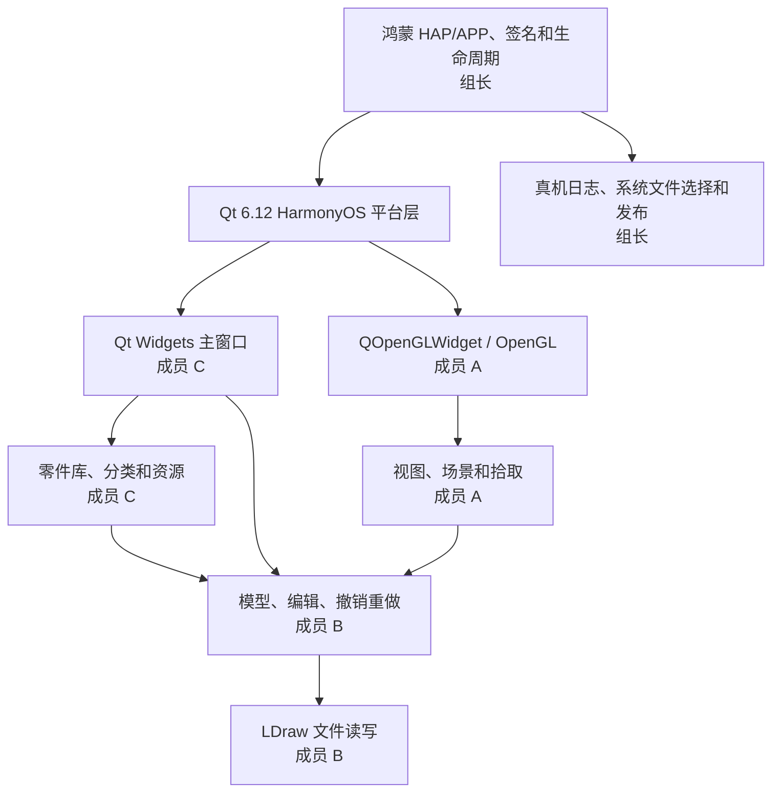

# LeoCAD 鸿蒙 PC 首发版：两周分工与技术方案

> 开发周期：2026 年 10 月 27 日—11 月 9 日，共 14 个自然日。
> 交付目标：在 11 月 9 日前形成可安装、可稳定完成核心建模闭环的鸿蒙 PC 正式签名包，并提交应用市场审核申请；市场审核完成时间不在本期承诺范围内。
> 团队：组长（唯一持有鸿蒙 PC 真机）＋成员 A＋成员 B＋成员 C。成员姓名可在项目启动时直接替换。

## 1. 项目结论和范围

本期不是完整复制桌面版 LeoCAD，而是交付“鸿蒙 PC 首发精简版”。产品必须跑通以下用户闭环：

1. 启动应用并加载内置零件库。
2. 新建模型，从分类或搜索结果中选择常用零件。
3. 添加、选择、移动、旋转、删除和修改颜色。
4. 使用鼠标完成 3D 视图旋转、平移和缩放。
5. 撤销和重做建模操作。
6. 打开、保存 `.ldr` 和 `.mpd` 基础模型。
7. 退出后重新打开已保存模型，内容保持一致。

### 1.1 首发版必须保留

- 单文档基础建模。
- 常用零件分类、搜索和颜色选择。
- 选择、插入、移动、旋转、删除。
- 视图旋转、平移、缩放、适应窗口。
- 撤销、重做。
- `.ldr`、`.mpd` 基础读写。
- 约 500—1500 个经许可核对的常用 LDraw 零件。
- 中文优先；来不及完整汉化时允许保留英文，但不允许出现乱码、截断或不可读文本。
- 鼠标和物理键盘的核心操作。
- 异常文件提示、空模型保护、保存失败提示。

### 1.2 首发版明确不做

- 打印、HTML 说明书、动画、复杂多模型步骤编辑。
- POV-Ray、Blender 等外部渲染或导出。
- 在线更新、在线零件下载、BrickLink 等联网功能。
- 文件关联、系统级复杂拖放、多窗口和多视图。
- 游戏手柄、触控专项适配。
- LXF、OBJ、3DS、COLLADA 等非核心导入导出格式。
- 完整 LDraw 零件库和非官方零件库。
- 原版全部偏好设置、帮助内容及高级渲染选项。

冻结范围后，任何新增功能必须用同等工作量的现有功能交换，不允许只增加、不删减。

## 2. 技术基线和架构

| 项目 | 固定选择 |
|---|---|
| 上游基线 | LeoCAD `v26.09`，Git 提交 `5196355d4a5adb35f14c97e7672d7a9bfd3af391`；保留原始源码，鸿蒙改动单独记录 |
| UI | 保留 Qt Widgets，不使用 ArkUI 重写主界面 |
| 3D 视图 | 保留 `QOpenGLWidget` 和 LeoCAD OpenGL 渲染；按鸿蒙实际图形能力做兼容补丁 |
| Qt | Qt 6.12 for HarmonyOS；固定实际安装版本、SDK 和编译器到 `toolchain.lock` |
| 构建 | DevEco Studio/Hvigor 负责 HAP/APP；CMake 包装现有 qmake 源文件清单并链接 Qt 模块及 zlib |
| 目标设备 | 鸿蒙 PC，ARM64；组长真机为发布验收基准设备 |
| 文件访问 | Qt 文件 API 负责应用沙箱内读写；系统文件选择/导入导出由鸿蒙宿主能力桥接，组长真机验收 |
| 零件库 | 包内携带精简库，首版完全离线；零件清单、来源、版本和许可证可追溯 |
| 网络 | 首版关闭在线更新和在线资源下载，不申请无必要的网络权限 |
| 许可证 | LeoCAD GPLv2；发布包内提供许可证、版权声明、第三方清单和对应源码获取方式 |



### 2.1 需要优先处理的平台差异

- `QOpenGLContext`、共享上下文、离屏 Surface 和帧缓冲对象的创建。
- OpenGL/GLSL 能力检测和不支持特性的降级；首版可关闭轮廓等非必要效果。
- `QOpenGLWidget` 尺寸、设备像素比、窗口缩放和重建后的资源恢复。
- 鼠标按键、滚轮、修饰键、焦点丢失和快捷键。
- 应用沙箱路径、系统文件选择结果、导入副本和导出目标。
- Qt 菜单、对话框、字体、中文输入以及窗口最小尺寸。
- 包内大批量小文件的读取效率；优先将精简零件库打包成可顺序读取的资源或首次运行时展开到版本化目录。

## 3. 四人分工与等量工作量

工作量按 40 点/人配置。点数用于比较相对投入，不表示小时；模块负责人除交付代码外，还负责修复自己模块在真机联调中暴露的问题。

| 人员 | 核心职责 | 工作量构成 | 合计 |
|---|---|---:|---:|
| **组长：平台、集成、真机与发布** | Qt/HarmonyOS 工程、CMake/HAP、每日集成；唯一真机安装、复现和验收；文件选择桥接；签名、上架和项目协调 | 工程与打包 10；集成和 CI 7；真机联调 10；签名上架 8；管理和审核 5 | **40** |
| **成员 A：图形渲染与输入交互** | OpenGL 上下文和兼容层；场景渲染、资源上传、拾取；鼠标键盘、视图导航和高分屏 | GL/上下文 12；视图渲染 10；输入和导航 8；性能、测试和缺陷 10 | **40** |
| **成员 B：建模内核与文件** | 模型对象和基础编辑；撤销重做；LDraw 打开保存；异常输入和数据一致性测试 | 模型编辑 12；撤销重做 6；文件和路径 10；自动化测试及缺陷 12 | **40** |
| **成员 C：界面、零件库与质量材料** | 主窗口精简、零件分类/搜索/颜色；精简库和资源；汉化；测试清单、隐私和开源材料初稿 | 界面 10；零件库 10；资源和语言 7；质量/发布材料 8；缺陷修复 5 | **40** |

### 3.1 源码责任边界

| 负责人 | 主要文件或目录 |
|---|---|
| 组长 | 新增 `platform/harmonyos/`、根 CMake/Hvigor 配置、HAP 资源、签名配置、`qt/qtmain.cpp` 的平台入口改动 |
| 成员 A | `lc_context.*`、`lc_glextensions.*`、`lc_view.*`、`lc_viewwidget.*`、`lc_scene.*`；`lc_assetloader.*` 中仅图形上传和上下文相关部分 |
| 成员 B | `lc_model.*`、`lc_modelhistory.*`、`project.*`、`piece.*`、`lc_file.*`、相关 Qt Test 和 LDraw 样例 |
| 成员 C | `lc_mainwindow.*`、`lc_partselectionwidget.*`、`lc_category.*`、`lc_color*`、`.ui`、`resources/`；`lc_library.*` 中仅库发现、索引和资源路径部分 |

共享热点文件处理规则：

- `lc_application.*`、根构建文件和应用入口由组长维护，其他人通过小型独立 PR 提交修改建议，不同时大改。
- `lc_library.*` 的零件索引由成员 C 维护，异步加载/GL 上传由成员 A 维护；涉及双方的 PR 必须互审。
- `project.*` 由成员 B 维护；成员 A/C 需要调整调用时先约定接口，再提交调用侧改动。
- 每次修改上游文件都保持变更最小，并在 `patches/` 或提交记录中说明鸿蒙原因。

## 4. 每人交付清单和 DDL

| 人员 | 必须提交的成果 | 阶段 DDL | 最终 DDL |
|---|---|---|---|
| **组长** | 可复现的 DevEco/CMake 工程；`toolchain.lock`；每日集成包；真机日志和缺陷表；系统文件选择桥接；正式签名包；应用市场提交记录 | **10/29** 真机启动主窗口；**10/31** 真机显示模型；**11/4** 完成文件选择和集成 Alpha；**11/7** RC1 | **11/9** 提交审核 |
| **成员 A** | GL 能力探针；鸿蒙兼容补丁；模型渲染、拾取、相机和输入实现；高分屏/窗口变化处理；性能及渲染测试记录 | **10/29** 上下文补丁；**10/31** 首个模型渲染；**11/3** 输入和基础编辑交互；**11/6** 性能与稳定性修复 | **11/8** 关闭图形阻断缺陷 |
| **成员 B** | 核心编辑补丁；撤销重做；`.ldr/.mpd` 读写；沙箱路径适配；固定样例、往返一致性和异常文件测试 | **10/30** 核心模型可编译；**11/1** 基础编辑；**11/3** 撤销重做；**11/5** 文件闭环 | **11/8** 关闭数据阻断缺陷 |
| **成员 C** | 精简主界面；零件选择/搜索/颜色；精简零件库和资源清单；中文资源；测试矩阵、商店文案、权限/隐私/许可证初稿 | **10/29** 零件清单与 UI 草案；**11/1** 零件面板；**11/4** 界面和资源冻结；**11/6** 发布材料初稿 | **11/8** 关闭 UI/材料阻断项 |

## 5. 14 天逐日计划

周末仍计入 14 天冲刺。若团队周末完全休息，11 月 9 日提交目标应顺延至少 4 天。

| 日期 | 组长：平台/真机/发布 | 成员 A：图形/交互 | 成员 B：模型/文件 | 成员 C：界面/零件/质量 | 当日统一出口 |
|---|---|---|---|---|---|
| **10/27 周二 D1** | 建仓、分支保护、CI 骨架；固定 SDK/Qt；建立 HAP/CMake 包装；创建上架事项表 | 在桌面编译基线；列出 GL、FBO、共享上下文和着色器风险；制作能力探针 | 跑上游 Qt Test；锁定核心编辑和文件范围；准备 LDraw 固定样例 | 清点主窗口/对话框；确定精简菜单和 500—1500 零件筛选原则；建立许可证清单 | 基线、接口、目录和范围冻结 |
| **10/28 周三 D2** | Qt Widgets＋`QOpenGLWidget` 最小 HAP 真机运行；记录系统/SDK/GPU 信息；完善构建文档 | 提交最小 GL 探针和上下文日志；开始 `lc_context` 兼容层 | 将模型/历史测试扩展为可独立构建；隔离非核心格式和网络路径 | 生成首版精简零件清单、分类和资源部署方案；提交精简 UI 草图 | 真机出现 Qt 窗口和 GL 画面 |
| **10/29 周四 D3** | 接入 LeoCAD 主程序；真机验证启动、退出、二次启动；将日志分派给负责人 | 完成上下文、Surface、GLSL 首轮补丁；提供无高级效果降级开关 | 核心模型代码通过 ARM64 编译；建立新建空模型测试 | 主窗口去除非本期菜单；零件库和图标能在桌面版加载 | 真机显示 LeoCAD 主窗口；未达成则红色预警 |
| **10/30 周五 D4** | 合入三模块；真机验证字体、菜单、窗口缩放和资源路径；维护阻断缺陷表 | 首个场景渲染；处理 FBO、深度缓冲、纹理上传问题 | 实现/验证插入、选择、移动、旋转、删除的核心调用 | 零件分类、搜索和颜色控件接入精简库；准备空库/损坏库提示 | 包内资源和核心模型同时可用 |
| **10/31 周六 D5** | 真机加载固定示例，保留截图与日志（组长决定不录屏）；采集渲染错误和性能数据；决定是否关闭额外效果 | 修复模型显示、相机、适应窗口；保证无轮廓效果时仍可用 | 在桌面测试核心编辑序列及模型状态；交首批固定测试 | 完成零件面板到插入命令的数据链；检查图标与高分屏 | 真机稳定显示模型；未达成则降级为轻量编辑器 |
| **11/1 周日 D6** | 组织第一次端到端集成；真机执行“选零件→插入→移动→保存前状态” | 完成鼠标旋转、平移、缩放和拾取；处理焦点丢失 | 完成基础编辑和对象状态更新；开始撤销重做 | 完成零件面板、分类、搜索、颜色和空状态；提交界面截图 | 建模前半闭环可用 |
| **11/2 周一 D7** | 接入系统文件选择和沙箱路径；真机验证窗口最小/最大化、缩放、快捷键 | 完成物理键盘、修饰键、滚轮和设备像素比；补输入测试表 | 完成撤销重做；开始 `.ldr/.mpd` 打开、保存和往返测试 | 完成中文资源、字体和常用提示；启动应用材料和隐私说明 | 输入与撤销重做进入同一包 |
| **11/3 周二 D8** | 合并 Alpha；真机跑完整建模闭环；发布功能冻结通知 | 只修交互/渲染缺陷，不再增加效果 | 完成基础 `.ldr/.mpd` 文件闭环和异常文件保护 | 完成全部首发界面和包内资源；停止新增页面 | **功能冻结：Alpha 可完成核心闭环** |
| **11/4 周三 D9** | 21:00 真机回归；测试启动、二次启动、文件选择取消、导入导出失败 | 修复黑屏、闪烁、尺寸错位、拾取偏移和上下文重建 | 修复读写、撤销重做、空模型、非法模型和路径问题 | 修复布局、字体、焦点、菜单状态；完善测试矩阵 | 阻断缺陷均有负责人和截止时间 |
| **11/5 周四 D10** | 真机做 30 分钟稳定性和中型模型测试；整理 hilog、崩溃和内存证据 | 优化首帧、重绘和资源上传；定义可接受模型规模 | 完成保存前后结构一致性、连续编辑和异常输入测试 | 优化零件索引和首启加载；完成隐私、权限和第三方清单 | 性能边界和已知限制写入发布说明 |
| **11/6 周五 D11** | 构建 RC0；执行安装、覆盖安装、卸载重装；启动提交页面预填信息 | 关闭 P0/P1 图形问题；提交渲染测试记录 | 关闭 P0/P1 数据问题；提交自动化和样例测试记录 | 冻结图标、截图方案、商店文案、许可证和源码获取说明 | RC0 与发布材料齐备 |
| **11/7 周六 D12** | 构建 RC1；真机全量回归；执行可用的云测试/安全扫描 | 复核不同窗口尺寸、休眠恢复和重新进入 | 复核打开→编辑→保存→重启→再打开 | 按 RC1 拍摄截图；复核商店文案、权限和隐私一致性 | RC1 通过核心验收，无 P0 |
| **11/8 周日 D13** | 只合并阻断修复；正式签名演练和上传预检；准备回退包 | 只修复验收阻断项，陪同分析真机日志 | 只修复验收阻断项，复跑数据测试 | 只修复验收阻断项，完成所有发布材料终审 | RC2 通过上传基础检测 |
| **11/9 周一 D14** | 最终回归、正式签名、上传并提交审核；保存提交记录和审核版本源码 | 待命处理最后的图形阻断问题 | 待命处理最后的数据阻断问题 | 复核应用详情页、截图、隐私和开源材料；待命修正 | **提交应用市场审核申请** |

## 6. 只有组长持有真机时的协作流程

### 6.1 固定真机批次

组长每天安排一次真机批次，固定在 21:00；紧急 P0 问题可临时增加批次。其他成员须在 20:30 前提交：

1. 待测试提交号和构建产物。
2. 不超过 10 步的复现/验收步骤。
3. 预期结果。
4. 需要捕获的日志关键字或截图位置。
5. 若失败，优先尝试的降级开关。

组长只负责统一构建、安装、执行步骤和回传证据，不替模块负责人长期调试其代码。真机失败后，组长在缺陷表中附上：

- 设备、系统、SDK、Qt 和应用版本。
- Git 提交号、HAP/APP 构建号。
- 最短复现步骤。
- `hilog`/崩溃栈、截图或录屏。
- 首次出现时间、是否稳定复现。
- 归属模块和严重级别。

模块负责人收到材料后在自己环境分析和修复，再进入下一真机批次。组长不接受没有提交号、没有预期结果或一次要求验证大量无关变化的测试包。

### 6.2 缺陷级别

| 级别 | 定义 | 处理要求 |
|---|---|---|
| P0 | 无法安装/启动、黑屏、核心闭环不可完成、数据损坏、正式包无法签名上传 | 立即停止新增工作；当天修复或启用预定降级方案 |
| P1 | 核心操作明显错误、频繁崩溃、严重输入/显示错位、常用模型无法打开保存 | 24 小时内修复，RC1 前全部关闭 |
| P2 | 非阻断 UI、性能或边缘兼容问题 | 视风险修复；否则写入已知问题 |
| P3 | 本期范围外功能和体验建议 | 进入后续版本，不占用两周资源 |

## 7. 分支、PR 和审核规则

分支建议：

```text
main                    始终保持可构建
release/harmony-first   D8 后的发布冻结分支
feature/leader-platform 组长
feature/a-render        成员 A
feature/b-model         成员 B
feature/c-ui-library    成员 C
```

PR 审核关系形成闭环：

| PR 作者 | 指定审核人 |
|---|---|
| 组长 | 成员 A |
| 成员 A | 成员 B |
| 成员 B | 成员 C |
| 成员 C | 组长 |

规则：

1. 每个 PR 只包含一个可构建、可回退的主题。
2. PR 必须写明目的、影响模块、构建方式、测试结果、待真机项和降级方式。
3. 至少一名非作者批准；组长统一合入 `main`，组长自己的 PR 经成员 A 批准后合入。
4. D8 后禁止功能型 PR，只允许 P0/P1 修复、发布材料和自动化测试改动。
5. AI 生成代码必须由模块负责人理解并审核，不允许以“AI 已检查”替代构建、测试和人工审查。

## 8. 接口约定

| 边界 | 约定 |
|---|---|
| 平台入口 → LeoCAD | 提供应用沙箱资源、文档、缓存目录；通知前后台、焦点、窗口尺寸和退出 |
| 文件选择 → 模型层 | 平台层返回可读/可写的本地路径或明确的取消/失败状态；模型层不直接依赖鸿蒙 API |
| Qt 视图 → 渲染层 | UI 线程创建并拥有主 GL 上下文；资源上传和共享上下文必须遵守 Qt 当前上下文规则 |
| 零件面板 → 模型层 | 只传递稳定零件 ID、颜色 ID 和插入命令，不让界面直接修改模型容器 |
| 模型层 → 文件层 | `.ldr/.mpd` 读写返回结构化成功/错误结果；保存采用临时文件成功后替换的策略 |
| 真机结果 → 模块负责人 | 统一使用缺陷模板和固定提交号；设备相关判断由组长确认，代码修复仍归模块负责人 |

## 9. 测试与验收

### 9.1 自动化和桌面对照测试

- 保留并运行上游 `tests/` 中的 Qt Test。
- 成员 B 增加固定模型编辑、撤销重做及 `.ldr/.mpd` 往返测试。
- 成员 C 对精简零件清单执行文件存在性、ID 唯一性、分类完整性和许可证清单检查。
- 成员 A 提供 GL 能力探针和渲染冒烟步骤；无法做像素级稳定断言时保留截图对照。
- 每次合入运行可在 CI 上执行的测试；真机项由组长在固定批次补记结果。

### 9.2 真机发布验收清单

- 干净安装、首次启动、退出和二次启动。
- 连续打开/关闭应用 10 次无崩溃、无持续黑屏。
- 新建模型并连续插入 20 个零件。
- 完成选择、移动、旋转、删除、颜色修改、撤销和重做。
- 旋转、平移、缩放和窗口尺寸改变后画面与点击位置一致。
- 打开固定 `.ldr`、`.mpd` 样例；取消文件选择不改变当前模型。
- 保存后退出，重新启动并再次打开，模型结构和零件数量一致。
- 无效/截断文件给出错误提示且应用继续可用。
- 连续建模 30 分钟无崩溃；记录内存、首启、模型打开和保存时间。
- 无网络时所有核心功能可用，不弹出联网错误。
- 包内图标、名称、版本、隐私说明和实际权限一致。
- 覆盖安装保留用户文档；卸载重装行为符合预期。

### 9.3 发布门槛

只有同时满足以下条件才允许提交：

- P0 为 0，P1 为 0；未修复 P2 已记录且不影响商店展示和核心闭环。
- RC2 在真机通过全部核心验收。
- 正式签名包与验收包哈希一致或可从同一提交复现。
- 应用市场基本资料、图标、截图、说明、隐私政策和权限说明齐全。
- GPLv2、Qt、zlib、LDraw 零件库及其他第三方许可证清单齐全。
- 已提供修改版对应源码或明确、有效的源码获取方式。
- 应用名称、图标以及 LeoCAD/LEGO/LDraw 相关商标使用已经核对。
- 开发者账号、实名、团队权限、备案和可能要求的资质不再阻塞提交。

## 10. 关键里程碑与止损

| 日期 | 必须达到的结果 | 未达到时的动作 |
|---|---|---|
| **10/29 D3** | 真机从 HAP 启动 LeoCAD 主窗口，可退出并重新打开 | 当天停止业务新增；组长和成员 A 集中处理平台入口/Qt；仍失败则重新评估 11/9 提交目标 |
| **10/31 D5** | 真机稳定显示固定 LDraw 模型 | 关闭轮廓、阴影、纹理和异步高级路径；改为最小可用渲染 |
| **11/3 D8** | 选零件→插入→编辑→撤销→保存→重开闭环可用 | 立即进一步削减 UI 和零件数量；不再增加任何功能 |
| **11/7 D12** | RC1 无 P0，核心 P1 全部关闭 | 若仍有数据损坏或高频崩溃，不提交正式审核，改走内部测试 |
| **11/9 D14** | 正式包通过上传基础检测并提交 | 保存全部证据，缺资质则先提交内部测试并单独跟进资质，不伪报完成 |

## 11. 工程目录建议

```text
leocad-harmony/
├── app/                         组长：DevEco/Hvigor、HAP 配置和资源入口
├── platform/harmonyos/          组长：生命周期、路径、文件选择和平台适配
├── upstream/leocad/             固定 v26.09 上游源码
├── cmake/                       组长：Qt/HarmonyOS 和第三方导入配置
├── patches/
│   ├── platform/                组长
│   ├── render/                  成员 A
│   ├── model/                   成员 B
│   └── ui-library/              成员 C
├── third_party/                 固定版本、来源、哈希和许可证
├── assets/ldraw-lite/           成员 C：精简零件库
├── tests/
│   ├── model/                   成员 B
│   ├── render/                  成员 A
│   ├── library/                 成员 C
│   └── device/                  组长：真机步骤和记录
├── scripts/                     构建、检查、资源打包和许可证汇总
├── docs/                        架构、接口、发布、隐私和已知问题
└── toolchain.lock               Qt、SDK、NDK、Clang、CMake 和提交号
```

每人的最终交付都必须包含：源码提交号、构建/接入步骤、测试结果、已知问题、待真机项以及出现问题时的降级方法。

## 12. 最终交付物

1. 可复现构建的完整源码、鸿蒙补丁和固定依赖说明。
2. 调试包、RC2 正式签名包及 SHA-256。
3. 精简 LDraw 零件库、清单、来源和许可证。
4. 自动化测试结果、桌面对照结果、真机回归记录和缺陷表。
5. 构建、安装、调试、签名和发布说明。
6. 应用图标、截图、商店文案、版本说明和已知限制。
7. 隐私政策、权限说明、第三方组件清单、GPLv2 文本和源码获取说明。
8. 应用市场上传/提交记录；如只能进入内部测试，明确记录实际状态和剩余阻塞项。

## 13. 参考资料

- [LeoCAD 官方仓库](https://github.com/leozide/leocad)
- [Qt 6.12 for HarmonyOS](https://doc.qt.io/qt-6/harmonyos.html)
- [Qt OpenGL 与 QOpenGLWidget](https://doc.qt.io/qt-6/qtopengl-index.html)
- [华为 HarmonyOS 应用提交说明](https://developer.huawei.com/consumer/cn/app/submit)
- [华为应用市场分发流程](https://developer.huawei.com/consumer/cn/appgallery/devstart/)

---

**计划成立的前提**：四人从 10 月 27 日同步开工，周末继续冲刺；组长拥有可用真机、DevEco/SDK、Qt for HarmonyOS、签名和开发者提交权限；D8 后严格冻结功能。两周目标是“首发精简版提交审核申请”，不是完整 LeoCAD 功能移植，也不承诺 11 月 9 日前完成市场审核。
